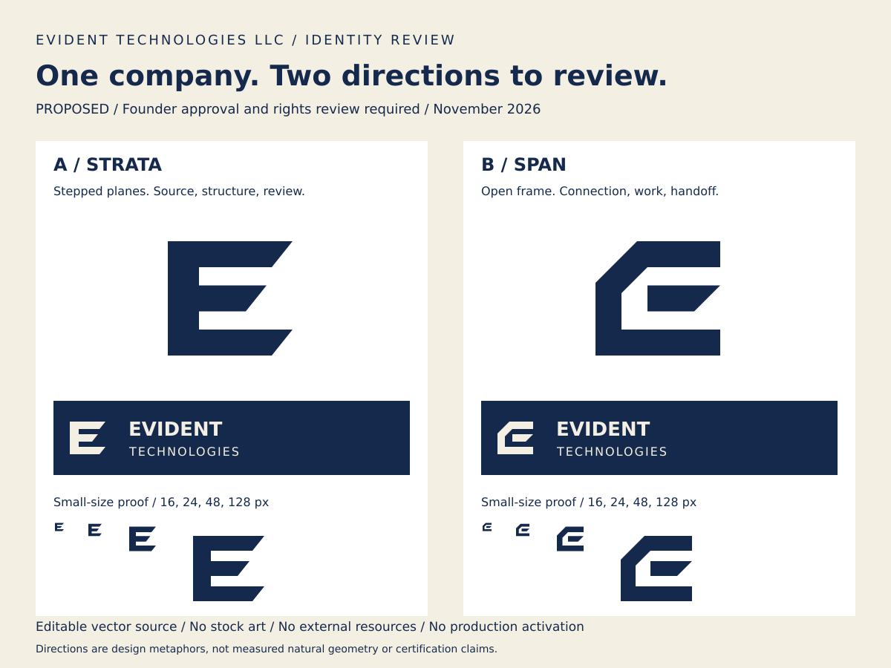

# Identity candidates for founder review

**Status: PROPOSED / UNAPPROVED.** No candidate is a permanent corporate mark, trademark clearance,
or production selection.

## Direction A: Strata

A continuous E structure with three chamfered planes. Its visual metaphor is layered information
becoming a usable structure. The geometry is authored on a 64-unit grid, with a broad 12-unit spine
and 10-unit bands. This is an aesthetic analogy, not measured natural geometry. The open silhouette
removes the historical shield, node, and certification-like check.

[Light lockup](candidate-a-lockup-light.svg) · [Dark lockup](candidate-a-lockup-dark.svg) ·
[Mark](candidate-a-mark.svg) · [Monochrome](candidate-a-mono.svg) ·
[Reversed](candidate-a-reversed.svg)

## Direction B: Span

An angular open frame with a separate horizontal member. The metaphor is a planned connection
between source and delivery. It shares the company's proposed typographic hierarchy and palette with
Strata but changes the structure of the mark. Geometry is authored on the same 64-unit grid; it does
not depict a seal, government insignia, or third-party logo.

[Light lockup](candidate-b-lockup-light.svg) · [Dark lockup](candidate-b-lockup-dark.svg) ·
[Mark](candidate-b-mark.svg) · [Monochrome](candidate-b-mono.svg) ·
[Reversed](candidate-b-reversed.svg)

## Source and use

All files are editable SVG. Shape-only marks have no font dependency. Lockups retain editable live
text with local font fallbacks; their exact metrics may vary across systems. No font file is
embedded or redistributed. Font outlining or a licensed typographic source can follow selection.

Use the icon alone at small sizes; do not shrink the full company lockup into a favicon. Preserve
aspect ratio and clear space of at least 8 grid units around the mark. Use the explicit light and
dark lockups rather than relying on external SVG color inheritance. Do not imply product
availability, certification, or confirmed state through the mark.

The [token proposal](tokens.json) retains navy and ivory for continuity. Gold is optional
decoration; text and essential graphics use checked high-contrast pairs. Neither color nor artwork
is the sole status label. The [manifest](manifest.json) records source revision, SHA-256 values,
authorship classification, rights limits, and a null approval record.

## Decision required

Choose, revise, or reject a direction after reviewing 16, 24, 48, and 128-pixel icons, larger
lockups, dark/light presentation, rights, and distinctiveness. Founder selection must name the exact
files and revision. Retirement and cross-repository migration remain separate dependency work. No
legacy asset is deleted or redirected by this proposal.
