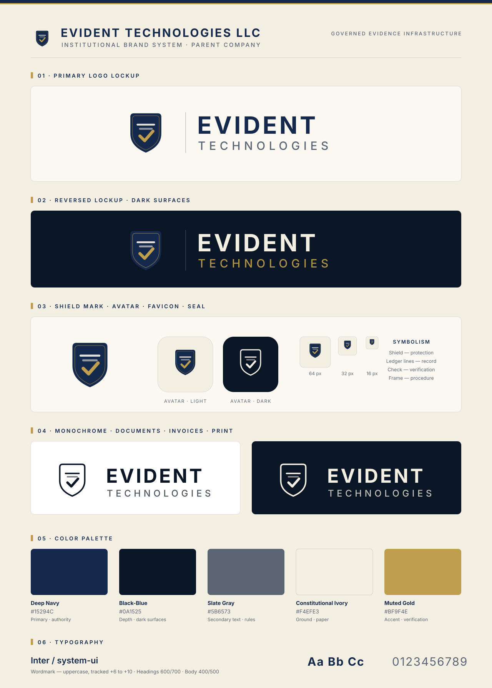
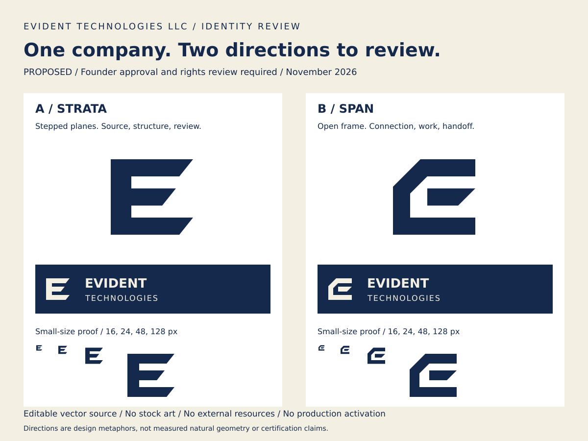

# Visual review

This compares preserved source with proposed artwork. It is not a screenshot of an approved GitHub profile.

## Existing identity

The historical system combines a shield, ledger-like E, node, check, navy, ivory, and gold. The board contains evidence-only positioning. Older ICU wordmarks are a separate product treatment with live text and a long court-grade tagline. Those sources remain unchanged for provenance and compatibility; their comments are not a verified approval record.

## Proposed identity directions

Strata uses stepped E planes. Span uses an open frame and separate member. Both keep the corporate name above product identity, use editable geometry, and avoid certification-like imagery. Neither is selected or active.

## Observed source proofs

All 24 existing and candidate SVG files were rasterized with the local Rsvg renderer. All three existing PNGs passed image decoding. Candidate icons were inspected at 16, 24, 48, and 128 pixels on light and dark grounds; the main silhouette and internal openings survived. Large light/dark lockups were inspected for cropping and text alignment. The comparison-board card height was corrected after its first proof showed the largest icon extending beyond the card.

Candidate text pairs measure 14.45:1 for navy on white, 12.59:1 for navy and ivory, and 5.91:1 for slate on white. Gold on white measures 2.53:1 and remains decorative. No information depends on color alone.

## Profile before and after

The main-branch profile centered on evidence infrastructure. Draft PR #28 introduced websites, design, and workflows. The reconstruction retains that direction and adds a clearer company/product relationship, assessment-based contracting tools, accessibility and handoff expectations, and private disclosure routing.

The proposed profile uses a text company heading while mark approval is pending. It has no logo image, badge, remote font, CDN dependency, or layout table. This avoids treating an unapproved candidate or historical product mark as the selected corporate identity.

## Review limits

Rsvg proofs establish observed local raster output, not browser equivalence. Lockup fonts remain editable and may render differently elsewhere. The official external Chrome connection was unavailable, so GitHub-rendered desktop/mobile layout, theme switching, 200% zoom, keyboard behavior, and screen-reader review were not performed. No in-app browser or alternate browser-control route was used. Founder selection, rights review, and cross-repository migration remain open.
